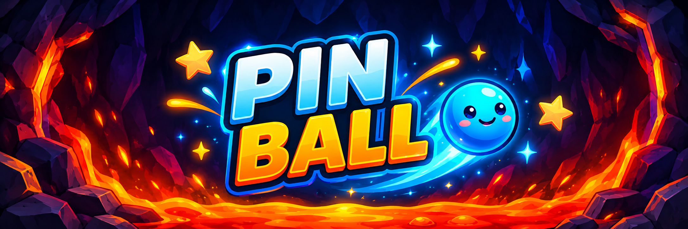

<div align="center">
  
</div>

<div align="center">

# 🎮 PIN BALL

### 🔵 Desvie da lava. ⭐ Colete estrelas. 🧡 Sobreviva!

Um jogo 2D desenvolvido em **Python**, com física, efeitos visuais neon e uma atmosfera de caverna vulcânica.

<p>
  
  
  
</p>

---

</div>

## ✨ Sobre o jogo

**PIN BALL** é um jogo 2D em que você controla uma bolinha azul em uma arena cheia de obstáculos. Use os movimentos laterais e o impulso vertical para alcançar as estrelas, aumentar sua pontuação e evitar a lava.

### 🌟 Destaques

- 🎯 **Pontuação:** colete estrelas espalhadas pela arena.
- ❤️ **Três vidas:** cada queda na lava custa uma vida.
- 🌀 **Física e colisões:** movimento e interação com obstáculos simulados pelo Pymunk.
- 💫 **Efeitos visuais:** rastro azul, partículas brilhantes e lava animada.
- 🎵 **Áudio:** música de fundo durante o jogo.
- 🖼️ **Interface personalizada:** menu inicial, ícones e tela de fim de jogo.

## 🕹️ Controles

| Tecla | Ação |
|:---:|---|
| ⬅️ | Mover para a esquerda |
| ➡️ | Mover para a direita |
| ⬆️ | Aplicar impulso para cima |
| `Espaço` / `Enter` | Iniciar ou recomeçar |
| `Esc` | Sair do jogo |
| 🖱️ Clique | Acionar o botão do menu |

## 🧰 Tecnologias

| Tecnologia | Uso no projeto |
|---|---|
| **Python** | Linguagem de programação |
| **Pygame 2.6.1** | Janela, desenho, teclado, eventos, fontes e áudio |
| **Pymunk 7.3.1** | Física, gravidade e colisões |
| **CFFI 2.1.1** | Interface usada por dependências nativas |
| **pycparser 3.11** | Dependência do CFFI |

## 📁 Estrutura do projeto

```text
PIN-BALL/
├── pin_ball.py
├── requirements.txt
└── assets/
    ├── background.jpeg
    ├── menu.jpeg
    ├── game_over.png
    ├── botao.png
    ├── fonte.ttf
    ├── coracao.png
    ├── estrela.png
    └── pin_ball_beat.ogg
```

> 💡 **Importante:** mantenha os arquivos com esses nomes dentro de `assets/`. O jogo usa caminhos relativos, então os comandos abaixo devem ser executados na pasta principal do projeto.

## ⚙️ Instalação

### 1. Pré-requisitos

- 🐍 Python instalado
- 📦 `pip`
- 🗂️ Arquivos do projeto, incluindo a pasta `assets/`

### 2. Crie um ambiente virtual (recomendado)

```bash
python -m venv .venv
```

**Linux / macOS**
```bash
source .venv/bin/activate
```

**Windows**
```powershell
.venv\Scripts\activate
```

### 3. Instale as dependências

```bash
python -m pip install -r requirements.txt
```

Opcionalmente, verifique se há conflitos:

```bash
python -m pip check
```

## 🚀 Como executar

Na pasta principal do projeto, rode:

```bash
python pin_ball.py
```

No Linux, caso o comando `python` não esteja disponível, tente:

```bash
python3 pin_ball.py
```

## 🏆 Objetivo e regras

1. ▶️ Inicie a partida pelo menu.
2. 🎮 Controle a bolinha com as setas.
3. ⭐ Encoste nas estrelas para ganhar pontos.
4. 🌋 Evite cair na lava para preservar suas vidas.
5. 🔁 Ao perder as três vidas, recomece pela tela de fim de jogo.

## 📌 Observações

- `requirements.txt` instala as bibliotecas Python, mas **não** inclui imagens, fontes ou música.
- Para manter a experiência visual e sonora esperada, preserve todos os arquivos da pasta `assets/`.

---

<div align="center">

### 🔵 PIN BALL · Python + Pygame + Pymunk 🟠

</div>
